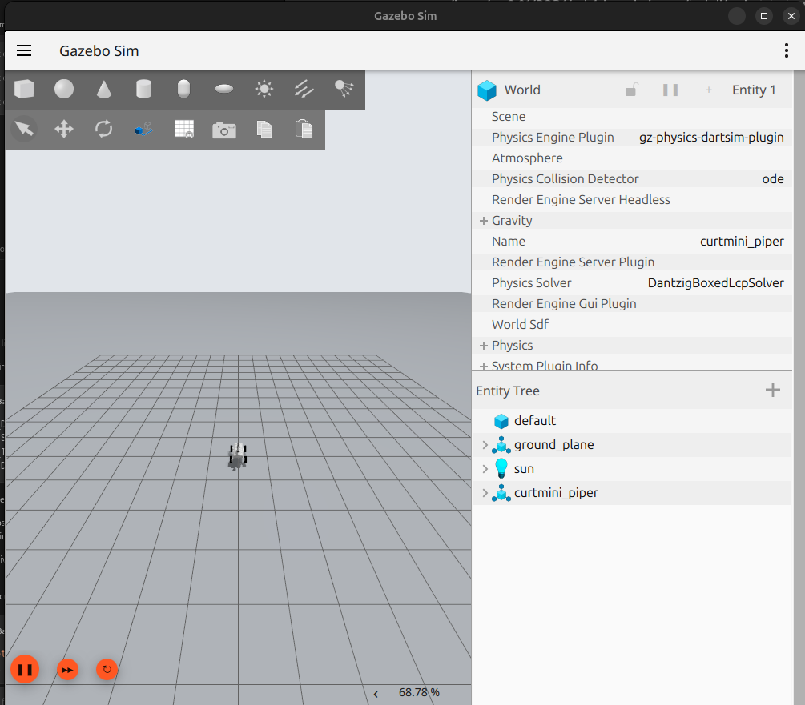
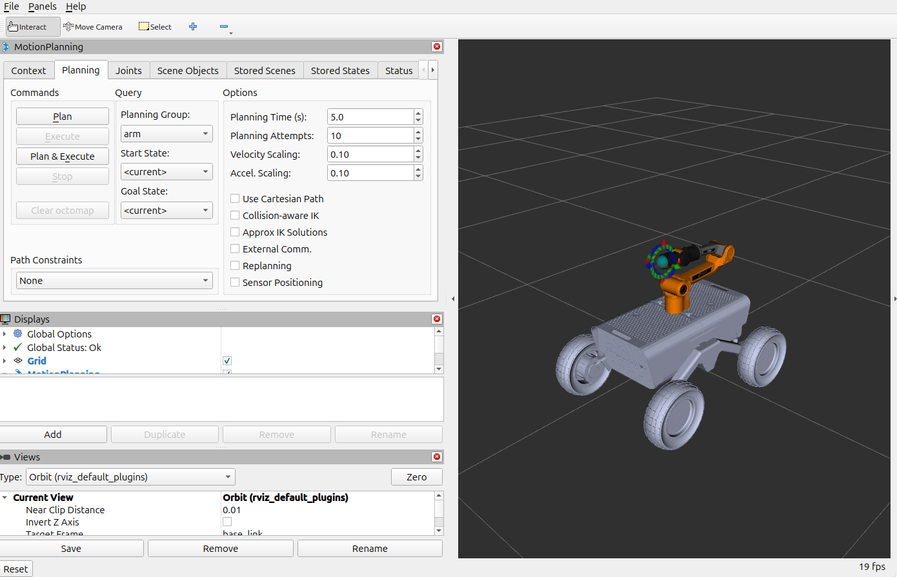

# Curtmini Piper gz sim (Gazebo Harmonic Simulation)

<table>
  <tr>
    <td width="50%" align="center">
      
    </td>
    <td width="50%" align="center">
      
    </td>
  </tr>
  <tr>
    <td align="center">Gazebo Harmonic</td>
    <td align="center">RViz/MoveIt</td>
  </tr>
</table>

## Build the package

Clone the dependency repos with `vcs` from the ROS workspace root. This
example uses the checkout layout in this workspace; adjust the path to
`dependencies.repos` if you cloned the simulator elsewhere:

```bash
vcs import src < src/curtmini_piper_simulation/curtmini_piper_gz_sim/dependencies.repos
```

Build and source the workspace:

```bash
colcon build --packages-up-to curtmini_piper_gz_sim
source install/setup.bash
```

Upstream ROS packages from `dependencies.repos` include:

- [curt_mini](https://github.com/ipa-may/curt_mini)
  - curt_mini_description
  - curt_mini_teleop
- [curtmini_piper](https://github.com/ipa-may/curtmini_piper)
  - curtmini_piper_description
  - curtmini_piper_moveit_config
- [agx_arm_urdf](https://github.com/ipa-may/agx_arm_urdf)
  - agx_arm_urdf
- [neo_gz_worlds](https://github.com/ipa-may/neo_gz_worlds)
  - neo_gz_worlds

## Run the package

Start Gazebo Harmonic, the simulated base and arm controllers, MoveIt, and
RViz:

```bash
ros2 launch curtmini_piper_gz_sim simulation.launch.py
```

The simulation uses one Gazebo-owned controller manager for both the Curt Mini
base and Piper arm. The launch starts the base and arm controllers and the
`joint_state_broadcaster`. Check that all three are active with
`ros2 control list_controllers`; `/joint_states` requires the broadcaster.

Set the startup pose in `config/initial_state.yaml`: `base.x`, `base.y`, and
`base.z` are metres, `base.orientation` is one rotation around Z in radians,
and the six `arm.piper_joint*` values are radians. The launch validates every
joint against the Piper's position limits before starting Gazebo. From the
simulator repository root, pass the source file to a local ROS launch so edits
take effect without rebuilding the package:

```bash
ros2 launch curtmini_piper_gz_sim simulation.launch.py \
  initial_state_file:=$(pwd)/config/initial_state.yaml
```

The launch defaults to the installed copy of that file when no path is given.
The Docker service bind-mounts this YAML file over the installed copy, so
editing it and restarting `gz-sim` applies a new startup pose. Bridge and
controller YAML files come from the upstream simulator image.

Arm, TCP, lidar, and nominal camera body mounts are read from
`curtmini_piper_description/config/geometry.yaml`. The regular Docker build
uses upstream `main` for the simulator and robot code. The local geometry YAML
is bind-mounted, so its mount values apply after restarting Gazebo and its
clients. Gazebo publishes the simulated cameras' mount transforms from that
YAML. Use the workspace overlay to build local URDF or simulator code changes.

`curtmini_piper_moveit_config/config/moveit_controllers_sim.yaml` sets MoveIt's
`trajectory_execution.allowed_start_tolerance` to `0.0`. This skips MoveIt's
check that a trajectory starts at the current joint positions. Keep the
`joint_state_broadcaster` active so MoveIt receives joint states for planning.
For a host installation, rebuild `curtmini_piper_moveit_config` after changing
this controller YAML. Regular Docker builds use the upstream copy; use the
workspace overlay to test a local controller YAML change.

Run without Gazebo and RViz windows for headless testing:

```bash
ros2 launch curtmini_piper_gz_sim simulation.launch.py \
  gui:=false use_rviz:=false
```

Select a world from `neo_gz_worlds` by name, without a full path:

```bash
ros2 launch curtmini_piper_gz_sim simulation.launch.py \
  world:=neo_workshop
```

Other installed options include `neo_office_empty`, `neo_workshop_2`, and
`office_harmonic_02`. The `world` argument searches this simulator's packaged
worlds first, then `neo_gz_worlds`; an explicit file path also works. The Neo
world files do not load the sensor systems used by this simulator's worlds, so
lidar and IMU data may be unavailable in them.

Joystick teleoperation is disabled by default. Enable it with
`start_joystick:=true`.

## Simulated D435i-like cameras

The launch enables two RGBD and IMU sensors by default. The base camera is
below the Hokuyo and the tool camera moves with `piper_tcp_link`. Their nominal
poses come from `curtmini_piper_description/config/geometry.yaml`. Gazebo uses
those poses to mount the sensors, while separate static TF publishers attach
`base_camera_link` to `chassis` and `tool_camera_link` to `piper_tcp_link`.
Camera body visuals appear in Gazebo and in the MoveIt RViz robot model.

For both cameras, color images use `/<name>/color/image_raw`, depth images use
`/<name>/depth/image_rect_raw`, camera calibration uses
`/<name>/color/camera_info` and `/<name>/depth/camera_info`, and IMU samples
use `/<name>/imu`. The names are `base_camera` and `tool_camera`. The simulated
RGBD sensor shares one calibration for color and depth; this is an approximation
of a D435i, not a replica of its stereo pipeline. The RViz configuration shows
both color and depth views and the TF tree. Use `use_cameras:=false` to turn off
the simulated sensors and their TF publishers.

To run without a Gazebo window but with RViz:

```bash
ros2 launch curtmini_piper_gz_sim simulation.launch.py gui:=false
```

## AprilTag navigation exercise

Enable the optional tag panels in either packaged world:

```bash
ros2 launch curtmini_piper_gz_sim simulation.launch.py \
  world:=curtmini_piper_map use_apriltags:=true
```

`config/apriltags.yaml` gives each panel's ID, black-square edge size, and pose
in world coordinates. The three supplied `36h11` textures have IDs 0, 1, and 2.
To change an exercise, edit that file and restart Gazebo; in Docker it is
bind-mounted as a single runtime file. For a native install, pass
`apriltag_layout_file:=/absolute/path/to/apriltags.yaml` to test edits without
reinstalling the package. The panels have collision geometry and can affect
the lidar scan and a new map. They are deliberately not published as
ground-truth ROS transforms:
the robot must observe them with its camera.

The base camera starts near the first panel. The optional `apriltag-base`
Compose service runs `apriltag_ros` on its color image and camera calibration,
publishing `/base_camera/tag_detections` and observed tag TFs. Set
`SIM_USE_APRILTAGS=true` and start `gz-sim`, `apriltag-base`, and
`moveit-rviz-sim` from the container repository. Keep `APRILTAG_SIZE` equal to
the black-square edge in the layout (0.20 m for the supplied panels). See the
project's AprilTag exercise guide for the full Docker workflow.

The tag bitmaps are copied from
[AprilRobotics/apriltag-imgs](https://github.com/AprilRobotics/apriltag-imgs)
under the BSD 2-Clause license in `models/apriltags/LICENSE`.

## Teleoperate the simulated robot with a keyboard

Start the robot in the mapping world:

```sh
ros2 launch curtmini_piper_gz_sim simulation.launch.py \
  world:=curtmini_piper_map
```

In a second sourced terminal, check the controllers after the robot has
spawned:

```sh
ros2 control list_controllers
```

One spawner loads and activates `joint_state_broadcaster`, `base_controller`,
and `arm_controller` in that order. It allows 30 seconds for each controller
switch and 40 seconds for each service response on the host, in Docker, and in
CI. If the spawner exits before completing, later controllers may not be
loaded. If the state broadcaster is loaded but `inactive` after a startup
timeout, retry its activation:

```sh
ros2 control switch_controllers --activate joint_state_broadcaster
```

`base_controller` must be `active` for keyboard driving.

In a third terminal, start keyboard teleoperation:

```sh
ros2 run teleop_twist_keyboard teleop_twist_keyboard --ros-args \
  -p stamped:=true \
  -p frame_id:=base_link \
  -r cmd_vel:=/base_controller/cmd_vel
```

Keep this terminal focused while driving. Use `i` and `,` to drive forward
and backward, `j` and `l` to rotate, and `k` to stop.

## Key topics

Use `ros2 topic list` to inspect the running simulation. Key topics are
`/clock` for simulation time, `/scan` for the Hokuyo lidar when the world loads
Gazebo's sensor system and `use_hokuyo:=true`, `/joint_states` when
`joint_state_broadcaster` is active,
`/base_controller/odom` for wheel odometry, and
`/arm_controller/controller_state` for arm-controller feedback. The launch also
configures an `/imu/data` bridge; IMU data requires a working Gazebo sensor.
